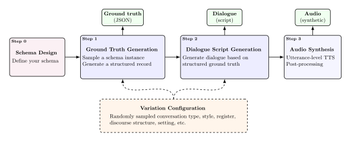

# conversim

Synthetic dialogue datasets with aligned structured ground truth, and optionally speech.

conversim writes the structured record first and the conversation from it, so the label is correct without anyone
annotating or checking it. Each sample is built in the reverse of the order it will be used in:

<p align="center">
  
</p>

The usual approach runs the other way: write a conversation, then extract a label from it. The labels are then only as
good as the extractor, which is often the system being evaluated.

Nothing in the core is domain-specific. You supply the schema, the roles, the personas and the variation axes.
`conversim.presets.sti` is a complete worked example, a German clinical history-taking dataset.

## Install

Not yet on PyPI. From a checkout:

```bash
uv add /path/to/conversim
```

Providers and speech backends are optional extras, so the base install (pydantic, numpy, soundfile) stays small:

```bash
uv add '/path/to/conversim[openai]'   # OpenAI + any OpenAI-compatible endpoint (vLLM, Ollama, llama.cpp)
uv add '/path/to/conversim[google]'   # Gemini
uv add '/path/to/conversim[qwen]'     # Qwen3-TTS voice cloning (pulls in torch)
```

To work on it, or to see the pipeline run end to end without any credentials:

```bash
uv sync && uv run pytest && uv run python examples/05_offline_demo.py
```

conversim never reads credentials from disk. Pass API keys explicitly, or let the provider SDK resolve its own
environment variable.

## Generating text

```python
from conversim import (
    DatasetSpec,
    GenerationConfig,
    Persona,
    RandomCasting,
    Role,
    SchemaSpec,
    StaticScenarioBuilder,
    generate_dataset,
)
from conversim.providers import GoogleProvider, OpenAIProvider

spec = DatasetSpec(
    schema=SchemaSpec(SupportTicket),  # your Pydantic model
    roles=(
        Role(id="agent", label="Agent"),
        Role(id="customer", label="Customer"),
    ),
    casting=RandomCasting(
        pools={
            "agent": (Persona(name="Sam", role="agent", description="Patient, methodical."),),
            "customer": (Persona(name="Kim", role="customer", description="In a hurry."),),
        }
    ),
    scenario=StaticScenarioBuilder(
        topic="a software support call",
        context="Inbound helpdesk line, business hours.",
        language="English",
    ),
)

result = generate_dataset(
    "out/support-calls",
    spec=spec,
    structured_provider=GoogleProvider(model="gemini-2.5-flash", api_key=...),
    text_provider=OpenAIProvider(model="gpt-5-mini", api_key=...),
    config=GenerationConfig(count=50, seed=1, concurrency=8),
)
print(result.summary())
# 50 generated, 0 skipped, 0 failed; 812,004 in / 214,556 out tokens
```

## Adding speech

Audio is a separate pass over an existing dataset. The GPU stage often runs later, on another machine, or more than
once:

```python
from conversim import AudioConfig, synthesize_dataset
from conversim.speech import MixConfig, QwenTTS, SwappedAssignment, VoiceLibrary

synthesize_dataset(
    "out/support-calls",
    AudioConfig(
        synthesizer=QwenTTS(device="cuda:1"),
        library=VoiceLibrary.from_directory("actors"),  # name.wav + name.txt pairs
        assignment=SwappedAssignment(limit=2),  # two takes, voices exchanged
        mix=MixConfig(pause_mean_s=0.25, allow_overlap=True),
    ),
)
```

`SwappedAssignment` renders the same dialogue twice with the voices exchanged. The words stay identical and each line is
spoken by the other voice, which doubles the speech data and isolates voice as a variable when comparing models.

Utterances are cached per `(voice, turn)`. Only the voices actually cast are rendered, so one take costs one utterance
per turn instead of one per turn per library voice. Re-mixing with different pacing, panning or room tone needs no new
synthesis. An interrupted run resumes at the granularity of a single utterance. Swapping is not free, though: both
permutations need both voices on every turn.

## Reading a dataset back

```python
from conversim import load_dataset

dataset = load_dataset("out/support-calls")
print(len(dataset), dataset.manifest().variation_cardinality)

for sample in dataset:
    if not sample.record.is_clean:
        continue  # skip samples with a major issue, e.g. an unparsable line
    label = sample.ground_truth_as(SupportTicket)  # validated
    target = sample.dialogue.transcript()  # ASR transcription target
    for take in sample.takes:
        take.timings  # per-turn start/end: diarization reference
```

## Designing diversity

Asked 400 times for "a realistic conversation", a model returns 400 variations of the same one. A `VariationSpace` turns
diversity into something you specify. Each axis is sampled once per conversation and goes into the ground-truth prompt
and the dialogue prompt alike, so the two stay consistent.

```python
from conversim import CategoricalAxis, FlagAxis, VariationOption, VariationSpace

space = VariationSpace(
    categorical=(
        CategoricalAxis(
            name="style",
            label="Register",
            options=(
                VariationOption(
                    value="concise",
                    instruction="brisk and efficient",
                    metadata={"turn_range": (12, 20)},
                ),
                VariationOption(
                    value="detailed",
                    instruction="thorough, lots of detail",
                    metadata={"turn_range": (30, 45)},
                ),
            ),
        ),
    ),
    flags=(
        FlagAxis(name="small_talk", instruction="Opens with brief small talk.", probability=0.2),
    ),
)
print(space.describe())  # axis inventory plus the size of the designed space
```

`StaticScenarioBuilder(turn_range_axis="style")` then takes dialogue length from whichever style was sampled.

## Topic planning

A ground-truth instance is a set of facts with no order to them. Handed over as it is, models walk the JSON from top to
bottom and produce checklist dialogue. Topic categories declare which schema fields they cover, and the planner
validates those paths against the schema when it is constructed:

```python
from conversim import PriorityRule, SchemaTopicPlanner, TopicCategory

planner = SchemaTopicPlanner(
    schema=SchemaSpec(SupportTicket),
    categories=(
        TopicCategory(
            name="greeting",
            description="Greeting and reason for calling.",
            position="early",
            always_include=True,
        ),
        TopicCategory(
            name="symptoms",
            description="What is failing, and since when.",
            field_paths=("problem.summary", "problem.first_seen"),
            priority=2,
        ),
        TopicCategory(
            name="resolution",
            description="Agreed next steps.",
            field_paths=("resolution.actions",),
            position="late",
        ),
    ),
    priority_rules=(PriorityRule(axis="style", value="concise", priorities={"symptoms": 1}),),
)
```

A misspelled path raises `SchemaError` and lists the available fields. Without that check, a category pointing at a
field that does not exist simply never activates, and the dataset ends up missing a whole subject area with nothing in
the logs to show for it.

Categories with no ground-truth content are dropped, so conversations stay as short as their facts warrant.

## Reproducibility

Per-sample seeds are derived from `(root_seed, index)` by hash, not drawn from a shared generator. Sample 37 is
therefore the same sample whether it ran first, last, or alone — concurrency does not perturb it. When no seed is given,
one is drawn and written to the manifest, so a run stays reproducible even if you did not plan to repeat it.

Everything needed to interpret a sample lives beside it: scenario, cast, sampled variation, topic plan, seed, models,
token usage and any validation issues.

## Layout

```bash
<root>/
  dataset.json                        run manifest, incl. the embedded JSON Schema
  samples.jsonl                       one index line per sample (derived, regenerable)
  samples/<sample_id>/
    sample.json                       provenance: scenario, cast, variation, models, seed
    ground_truth.json                 the extraction label
    dialogue.jsonl                    utterances, one JSON object per line
    dialogue.txt                      the same, as a readable script
    dialogue.raw.txt                  raw model output — only if parsing changed anything
    transcript.txt                    spoken words only: the ASR target
    prompts/{ground_truth,dialogue}.txt
    audio/
      segments/<voice_id>/0000.wav    per-turn renders, shared across takes
      takes/<take_id>.wav             mixed conversation
      takes/<take_id>.json            assignment, per-turn timings, mix settings
```

Everything is plain JSON or text, so a sample can be read and checked without tooling.

## Mixing

Utterances concatenated back to back are easy to recognise as synthetic. The mixer places each speaker at a fixed point
in the stereo field, varies pacing (optionally into overlap), jitters levels, adds listener backchannels to longer
turns, and runs room tone underneath. It needs only NumPy and `soundfile`, no `ffmpeg` and no `pydub`.

Mixing yields exact turn timings, which are recorded per take. A dataset is therefore usable for diarization and
streaming evaluation without forced alignment.

## Backends

|            | Provider         | Notes                                                                          |
|------------|------------------|--------------------------------------------------------------------------------|
| Structured | `GoogleProvider` | Gemini `response_schema`; enforced server-side                                 |
| Structured | `OpenAIProvider` | strict structured output, or `structured_mode="json_object"` for local servers |
| Text       | both             |                                                                                |
| Speech     | `QwenTTS`        | local voice cloning; best German quality, nothing leaves the machine           |
| Speech     | `OpenAITTS`      | no GPU needed; honours `(cue)` delivery annotations                            |

Both provider interfaces are `typing.Protocol`s, so a stub in your tests or an in-house gateway works without
subclassing anything.

The Qwen path has an opt-in integration test, skipped by default because it needs a CUDA device and downloads several
gigabytes of weights:

```bash
CONVERSIM_QWEN_DEVICE=cuda:1 CONVERSIM_QWEN_VOICES=/path/to/actors uv run --extra qwen pytest tests/test_qwen_integration.py -v
```

It covers what a stub cannot: the real `generate_voice_clone` signature, that reference audio decoded with `soundfile`
is accepted, the sample rate the model actually returns, that swapped takes really change who says what, and that
`QwenTTS.unload()` gives the VRAM back.

## The STI preset

`conversim.presets.sti` is a full domain pack: a German STI/HIV history-taking schema, a variation space, topic
categories with priority rules, doctor and patient personas, and localised prompt builders.

```python
from conversim.presets.sti import sti_dataset_spec

spec = sti_dataset_spec()
```

It also serves as the reference for writing your own.

## The dataset

[`dataset/`](dataset/README.md) holds **StiAna**, the corpus this library was
built to produce: 480 German STI/HIV history-taking consultations.

| Split        | Samples | Per sample                                                                                                   |
|--------------|---------|--------------------------------------------------------------------------------------------------------------|
| `sti_cloned` | 401     | record and script                                                                                            |
| `sti_simple` | 51      | script only — the negative control for the diversity analysis, generated without the variation configuration |
| `sti_real`   | 28      | the same as `sti_cloned`; the held-out evaluation split, with hand-curated records                           |

It ships with a JSON Schema of the record, the extraction system prompt used in
our experiments, generation prompts as examples, and a manifest. The recordings
behind `sti_real` are not included; the speakers did not consent to distributing
the audio.

**Provenance.** StiAna was generated between November 2025 and February 2026
with the research scripts of this project. conversim is a restructured,
documented and tested version of those scripts, prepared for release with the
help of Claude (Anthropic). Prompts, variation axes, personas, topic planner and
schema were carried over.

## The models

Our two best adapters trained on StiAna are on the Hugging Face Hub:

| Model                                                                                                    | Task                                       | Base                    |
|----------------------------------------------------------------------------------------------------------|--------------------------------------------|-------------------------|
| [whisper-medium-sti-anamnese-lora](https://huggingface.co/Superkon3000/whisper-medium-sti-anamnese-lora) | German STI/HIV consultation transcription  | `openai/whisper-medium` |
| [Llama-3.1-8B-sti-anamnese-lora](https://huggingface.co/Superkon3000/Llama-3.1-8B-sti-anamnese-lora)     | Transcript to schema-compliant JSON record | Llama 3.1 8B Instruct   |

Both are LoRA adapters, both are for research use, and neither is a medical device.

## Examples

| File                              | What it shows                                | Needs    |
|-----------------------------------|----------------------------------------------|----------|
| `examples/01_quickstart.py`       | Smallest real run, custom schema             | API keys |
| `examples/02_sti_dataset.py`      | The bundled STI preset, with CLI flags       | API keys |
| `examples/03_synthesize_audio.py` | Local Qwen3-TTS voice cloning, swapped takes | GPU      |
| `examples/04_custom_domain.py`    | Building a domain pack from scratch          | API keys |
| `examples/05_offline_demo.py`     | The full pipeline with canned backends       | nothing  |

## License

The library is Apache-2.0. See [LICENSE](LICENSE) and [NOTICE](NOTICE).

The dataset in [`dataset/`](dataset/) is licensed separately under
[CC BY 4.0](dataset/LICENSE), which is the usual arrangement for data shipped
alongside code.
